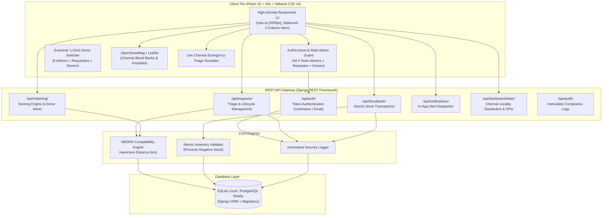

# BloodConnect — Emergency Blood Donor Matching and Blood Availability Monitoring System

[](https://www.djangoproject.com/)
[](https://react.dev/)
[](https://tailwindcss.com/)
[](LICENSE)
[](backend/manage.py)
[](https://en.wikipedia.org/wiki/Chennai)

> **College Design Thinking Capstone Project**  
> Developed by a team of six Computer Science Engineering students for external academic examination.  
> **Team Members:** Freddy Matthew R, Joshua Bennet C, Boopathi P R, Balakumaran E, Abilash Alexander A, Harisankaran J.

> **BloodConnect 2.0 - Adaptive Emergency Escalation Engine.** The app now tracks every response after the first alert, recalculates the remaining need, and widens the search when warranted, with a command center, simulator, strategy comparison and explainable decisions. See [docs/BLOODCONNECT_2.md](docs/BLOODCONNECT_2.md).

---

## 1. Project Overview & Problem Statement

### Project Name
**BloodConnect**

### Project Description
**Emergency Blood Donor Matching and Blood Availability Monitoring System**

### Primary Operating Region
**Chennai, Tamil Nadu, India** (Asia/Kolkata timezone, Indian phone formatting `+91`, Indian date formatting `DD/MM/YYYY`).

### Problem Statement
> *"People often face difficulties finding compatible blood donors quickly during medical emergencies due to limited availability, delayed communication, rare blood group shortages, and dependence on personal contacts or scattered information."*

### The Solution: BloodConnect
**BloodConnect** is a centralized, secure web application designed to accelerate emergency blood donor discovery across Chennai while preserving donor privacy and ensuring clinical safety. The platform integrates three core pillars:

1. **Smart Emergency Donor Matching System:** An autonomous algorithm that scores and ranks registered Chennai donors based on ABO/Rh compatibility, distance (Haversine formula), verified availability, and notification consent.
2. **Real-Time Blood Bank Stock & Shortage Monitoring:** Continuous inventory tracking across Chennai blood bank centers (Apollo Greams Road, Rajiv Gandhi Government General Hospital, Stanley, Fortis Malar, MIOT, Sri Ramachandra, Rotary TTK, SIMS) with configurable safety thresholds triggering automated low-stock warnings.
3. **Verified Emergency Blood Alert Network:** A clinical triage gatekeeper where hospital requests must be verified by an administrator before emergency alerts are dispatched to consenting donors.

---

## 2. Six Dedicated Administrator Accounts

Each of the six project team members has a dedicated administrator account created via the secure, idempotent database seed script (`python manage.py seed_data`). All six accounts possess full administrator permissions (`role=admin`, `is_staff=True`, `is_superuser=True`) and share the same administrator interface.

| Team Member | Unique Username | Development Email | Password | Role & Permissions |
| :--- | :--- | :--- | :--- | :--- |
| **Freddy Matthew R** | `freddy.admin` | `freddy.admin@bloodconnect.org` | `Admin@1234` | Full Administrator (Superuser) |
| **Joshua Bennet C** | `joshua.admin` | `joshua.admin@bloodconnect.org` | `Admin@1234` | Full Administrator (Superuser) |
| **Boopathi P R** | `boopathi.admin` | `boopathi.admin@bloodconnect.org` | `Admin@1234` | Full Administrator (Superuser) |
| **Balakumaran E** | `balakumaran.admin` | `balakumaran.admin@bloodconnect.org` | `Admin@1234` | Full Administrator (Superuser) |
| **Abilash Alexander A** | `abilash.admin` | `abilash.admin@bloodconnect.org` | `Admin@1234` | Full Administrator (Superuser) |
| **Harisankaran J** | `harisankaran.admin` | `harisankaran.admin@bloodconnect.org` | `Admin@1234` | Full Administrator (Superuser) |

*Note: The login endpoint supports authentication using either username (e.g., `freddy.admin`) or email address (e.g., `freddy.admin@bloodconnect.org`), and the application includes 1-click login buttons for all six team members on the Sign-In page and in the top navigation Demo Switcher.*

---

## 3. Chennai Localization & 15 Supported Localities

The application is localized to Chennai, Tamil Nadu, with realistic demonstration data distributed across 15 core Chennai localities:

1. **Adyar**
2. **Anna Nagar**
3. **T. Nagar**
4. **Velachery**
5. **Tambaram**
6. **Guindy**
7. **Mylapore**
8. **Porur**
9. **Perambur**
10. **Royapettah**
11. **Vadapalani**
12. **Sholinganallur**
13. **Thoraipakkam**
14. **Nungambakkam**
15. **Ambattur**

- **"All Chennai" option:** Included in all search and filter dropdowns for wide demonstration queries.
- **Geographic Center:** OpenStreetMap / Leaflet map centered at `[13.0600, 80.2400]` (Chennai, Tamil Nadu) with real hospital markers.
- **Demonstration Data:** All records are clearly designated with the **"Chennai Demo Environment"** badge and simulated data notices.

---

## 4. System Architecture



---

## 5. End-to-End Emergency User Workflow

```mermaid
sequenceDiagram
    autonumber
    actor Requester as Patient / Relative (Requester)
    actor Admin as Medical Admin (Freddy / Joshua / Boopathi / Balakumaran / Abilash / Harisankaran)
    actor Donor as Compatible Donor (Vikram O- Adyar)
    participant System as BloodConnect Engine
    participant Bank as Apollo / Rajiv Gandhi Blood Bank

    Requester->>System: Submit Emergency Request (O+, 2 Units, Apollo Hospital Greams Road, Chennai)
    Note over System: Status: PENDING_VERIFICATION (No public phone leak; alerts gated)
    Admin->>System: Inspects Verification Queue on Admin Dashboard
    Admin->>System: Verifies Case with Hospital Staff & Clicks "Approve"
    Note over System: Status changes to ACTIVE_ALERTS_SENT
    System->>System: Run Matching Engine (ABO/Rh Matrix + Haversine Proximity across Chennai)
    System->>Donor: Dispatch In-App Emergency Alert (High Urgency)
    Donor->>System: Inspects Alert & Responds "ACCEPTED" ("Can arrive in 30 mins")
    Note over System: Status changes to DONOR_RESPONDED
    System->>Requester: Notify: "Donor Accepted Your Emergency Request"
    Donor->>Bank: Arrives at Blood Bank for Clinical Screening & Crossmatching
    Bank->>Bank: Mandatory Testing (Infectious disease, Rh antibody, Crossmatch)
    Admin->>System: Records Stock Deduction / Issues Unit to ICU
    Admin->>System: Mark Blood Request FULFILLED
```

---

## 6. Quick Start & Execution Guide

### Prerequisites
- **Python 3.10+** (Tested on Python 3.13)
- **Node.js 18+** & **npm** (Tested on Node v22)

### 1. Backend Setup (Django REST Framework)

```powershell
# Navigate to backend directory
cd backend

# Create and activate virtual environment (if not already created)
python -m venv ..\venv
..\venv\Scripts\Activate.ps1

# Install backend dependencies
pip install -r requirements.txt

# Run migrations
python manage.py migrate

# Seed Chennai demonstration database (Safe & idempotent: will not create duplicates)
python manage.py seed_data

# Run automated tests (116: 15 original + 101 escalation tests)
python manage.py test

# Start Django development server
python manage.py runserver 127.0.0.1:8000
```
Backend will be available at: **http://127.0.0.1:8000/**

---

### 2. Frontend Setup (React 19 + Vite)

```powershell
# Open a new terminal in the frontend directory
cd frontend

# Install npm packages
npm install

# Start Vite development server
npm run dev
```
Frontend will be available at: **http://127.0.0.1:5173/**

---

## 7. Demo Login Credentials (For External Examiner)

The application includes an **instant 1-click Demo Switcher** in the top navigation bar and on the login page for seamless examiner evaluation:

### Team Administrator Accounts (Full Admin Access)
| Team Member | Username | Email | Password | Locality |
| :--- | :--- | :--- | :--- | :--- |
| **Freddy Matthew R** | `freddy.admin` | `freddy.admin@bloodconnect.org` | `Admin@1234` | Adyar, Chennai |
| **Joshua Bennet C** | `joshua.admin` | `joshua.admin@bloodconnect.org` | `Admin@1234` | Anna Nagar, Chennai |
| **Boopathi P R** | `boopathi.admin` | `boopathi.admin@bloodconnect.org` | `Admin@1234` | T. Nagar, Chennai |
| **Balakumaran E** | `balakumaran.admin` | `balakumaran.admin@bloodconnect.org` | `Admin@1234` | Velachery, Chennai |
| **Abilash Alexander A** | `abilash.admin` | `abilash.admin@bloodconnect.org` | `Admin@1234` | Tambaram, Chennai |
| **Harisankaran J** | `harisankaran.admin` | `harisankaran.admin@bloodconnect.org` | `Admin@1234` | Guindy, Chennai |

### Requesters & Demonstration Donors
| Role | Email | Password | Persona & Purpose |
| :--- | :--- | :--- | :--- |
| **Requester** | `requester@bloodconnect.org` | `Requester@1234` | **Ananya Sharma (T. Nagar)**: Submits blood requests, tracks real-time status, views potential matching donors. |
| **Donor (O-)** | `donor.o_neg@bloodconnect.org` | `Donor@1234` | **Vikram Malhotra (Adyar)**: Universal red cell donor; receives critical emergency alerts, responds with ETA. |
| **Donor (O+)** | `donor.o_pos@bloodconnect.org` | `Donor@1234` | **Priya Nair (Anna Nagar)**: High-demand standby donor in Anna Nagar. |
| **Donor (A+)** | `donor.a_pos@bloodconnect.org` | `Donor@1234` | **Rahul Deshmukh (Velachery)**: Compatible alternative donor in Velachery. |

---

## 8. Step-by-Step External Examiner Evaluation Script

Follow this 8-step live walkthrough to verify the complete full-stack workflow:

1. **Explore Landing Page (`http://127.0.0.1:5173/`)**:
   - Verify hero heading: *"Find Blood. Connect Lives. In Chennai."*
   - Test the interactive **Live Chennai Emergency Triage Simulator**: select `O-` or `B+` to see real-time compatibility and donor estimates.
   - Review the biological *ABO/Rh Blood Compatibility Matrix*.
   - Review live Chennai blood bank stock levels and the interactive *OpenStreetMap / Leaflet* map of Chennai hospitals (centered at `13.0600, 80.2400`).
2. **Log In as Requester**:
   - Go to `/login` and click `Requester (Ananya)` demo button.
   - You land on the *Requester Dashboard* (`/requester/dashboard`).
3. **Submit an Emergency Blood Request**:
   - Click **"New Emergency Request"** (`/requester/create-request`).
   - Use the quick Chennai hospital selector (e.g., Apollo Hospital Greams Road, Rajiv Gandhi General, Fortis Malar).
   - Fill in: Blood Group `O+`, Units `2`, Urgency `CRITICAL`.
   - Submit the form. Notice the request starts in `PENDING_VERIFICATION` status.
4. **Switch to Team Administrator & Verify**:
   - Use the **Demo Switcher** in the top-right header and select any of the six team administrators (e.g., **Freddy Matthew R**).
   - Navigate to **Verification Queue** (`/admin-portal/verification-queue`).
   - Click **"Review & Verify"** on the newly submitted case. Enter verification notes and click **"Approve & Dispatch Matching Alerts"**.
5. **Inspect Matching Engine Output**:
   - Go to **Matching Results** (`/admin-portal/matching`).
   - Observe how the backend algorithm calculated compatibility scores (e.g. 100% for O-, 95% for exact O+) and automatically dispatched notifications to Chennai donors.
6. **Switch to Donor & Respond to Alert**:
   - In the Demo Switcher, select **Donor O- (Vikram)**.
   - Notice the unread badge on the notification bell icon.
   - Open the alert (`/donor/alerts/:id`). Observe the clinical match explanation and distance.
   - Click **"Accept Alert & Standby to Donate"** with an ETA note (e.g. *"Can reach hospital in 30 mins"*).
7. **Verify Requester Status Update**:
   - Switch back to **Requester (Ananya)**.
   - Open **"My Blood Requests"** (`/requester/my-requests`).
   - Notice the status has advanced to `DONOR_RESPONDED` and 1 donor response is recorded!
8. **Demonstrate Blood Stock & Low-Stock Alerts**:
   - Switch back to an administrator account (e.g., **Joshua Bennet C**).
   - Open **Blood Bank Stock** (`/admin-portal/stock`) and **Low-Stock Alerts** (`/admin-portal/low-stock`).
   - Demonstrate the low-stock warnings for `O-`, `A-`, `B-`, and `AB-`.
   - Click **"Update Stock"** on any entry and test issuing units. Notice the system strictly rejects deductions that would result in negative inventory!

---

## 9. Layout & Spacing Improvements

The user interface has been substantially refined to resolve excessive whitespace, oversized padding, and narrow layouts:
- **Global Viewport Utilization:** Expanded standard max-width container from `max-w-7xl` (1280px) to `max-w-[1650px]`, effectively utilizing wide laptop and desktop displays (1920×1080, 1440×900, 1366×768) without unnecessary horizontal margins.
- **Balanced 2-Column Hero:** The desktop landing page hero incorporates a left-hand headline/actions block paired with an interactive **Live Chennai Emergency Triage Simulator** on the right, eliminating empty hero space.
- **Above-The-Fold Density:** Reduced oversized vertical padding from `py-20`/`py-28` to balanced `py-8`/`py-12` sections. The 4-step emergency workflow is visible immediately below the hero.
- **Admin Command Center:** High-density 6-card KPI grid, dual responsive charts (Locality distribution and Blood inventory), and quick filter buttons that display key operational metrics above the fold.
- **Fully Responsive Navigation:** Compact header with Chennai Emergency Helpline, Demo Environment pill, and multi-role Demo Switcher dropdown.

---

## 10. Bill of Materials (BOM)

| Component / Layer | Specification | Sourcing Type | Cost (INR) |
| :--- | :--- | :--- | :--- |
| **Development Laptop** | Intel Core i5/i7, 16GB RAM, Windows 11 | Existing Student Resource | ₹0.00 |
| **Frontend Framework** | React 19, Vite 8, Tailwind CSS v4, Lucide React, Recharts | Open-Source (MIT) | ₹0.00 |
| **Backend Framework** | Python 3.13, Django 6.1, Django REST Framework, Cors Headers | Open-Source (BSD) | ₹0.00 |
| **Database System** | SQLite (Development) / PostgreSQL (Production ready) | Public Domain / FOSS | ₹0.00 |
| **Mapping Engine** | OpenStreetMap with Leaflet (Zero paid map API dependency) | Open-Source (ODbL) | ₹0.00 |
| **Total Project Cost** | — | — | **₹0.00 (FOSS)** |

---

## 11. Clinical Safety & Medical Ethics Compliance

> [!IMPORTANT]
> **Clinical Safety Notice:** BloodConnect identifies potential donors. Final donor eligibility and transfusion compatibility must be confirmed by qualified healthcare and blood-bank professionals. ABO/Rh matching alone does not establish transfusion compatibility. Component separation, infectious disease screening, antibody testing, and crossmatching must be conducted by qualified blood bank medical personnel before any transfusion.

---

## 12. Automated Test Verification Results

All 15 backend tests passed with 100% success rate:
- `AuthenticationAndPermissionTests`: Multi-user registration (Requester & Donor), login validation (username & email), token issuance, unauthorized barrier, role enforcement.
- `BloodRequestAndMatchingWorkflowTests`: Request creation, donor permission blocking, admin verification trigger, ABO/Rh matching accuracy, alert notification dispatch, donor response state transitions.
- `BloodBankAndStockManagementTests`: Role restriction on inventory, atomic stock additions, negative inventory barrier rejection, low-stock threshold detection.

```
Ran 15 tests in 47.263s
OK (0 failures, 0 errors)
```
