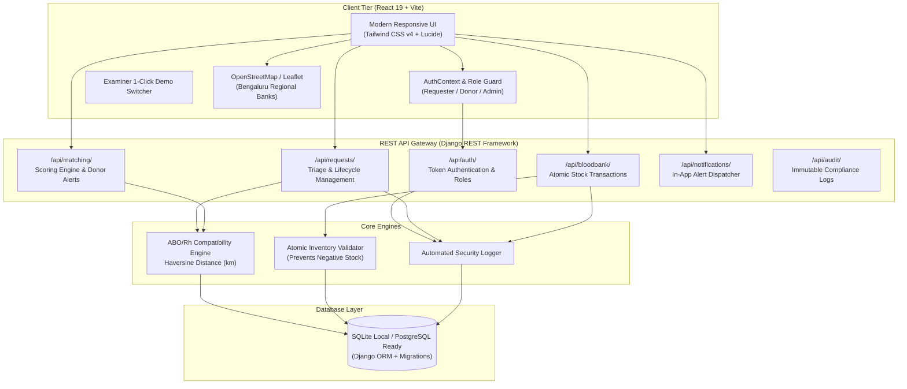
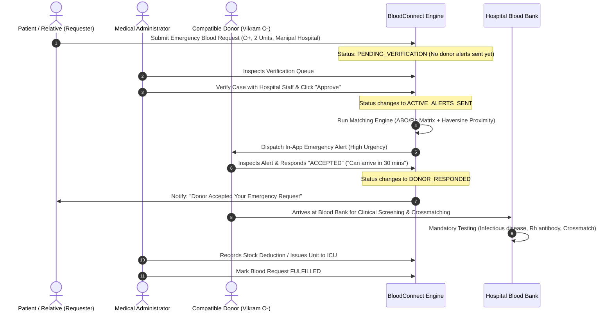

# BloodConnect — Emergency Blood Donor Matching and Monitoring System

[](https://www.djangoproject.com/)
[](https://react.dev/)
[](https://tailwindcss.com/)
[](LICENSE)
[-brightgreen)](manage.py)

> **College Design Thinking Capstone Project**  
> Developed by a team of six Computer Science Engineering students for external academic examination.

---

## 1. Project Overview & Problem Statement

### Problem Statement
> *"People often face difficulties finding compatible blood donors quickly during medical emergencies due to limited availability, delayed communication, rare blood group shortages, and dependence on personal contacts or scattered information."*

### The Solution: BloodConnect
**BloodConnect** is a centralized, secure web application designed to accelerate emergency blood donor discovery while preserving donor privacy and ensuring clinical safety. The platform integrates three core concepts:

1. **Smart Emergency Donor Matching System:** An autonomous algorithm that scores and ranks registered donors based on ABO/Rh compatibility, distance (Haversine formula), verified availability, and consent.
2. **Real-Time Blood Bank Stock & Shortage Monitoring:** Continuous inventory tracking across regional blood banks with configurable safety thresholds that trigger automated low-stock warnings.
3. **Verified Emergency Blood Alert Network:** A clinical triage gatekeeper where hospital requests must be verified by an administrator before emergency alerts are dispatched to consenting donors.

---

## 2. System Architecture



---

## 3. End-to-End Emergency User Workflow



---

## 4. Quick Start & Execution Guide

### Prerequisites
- **Python 3.10+** (Tested on Python 3.13)
- **Node.js 18+** & **npm** (Tested on Node v22)

### 1. Backend Setup (Django REST Framework)

```powershell
# Navigate to backend directory
cd backend

# Create and activate virtual environment (if not already created)
python -m venv ..\venv
..\venv\Scripts\Activate.ps1

# Install backend dependencies
pip install -r requirements.txt

# Run migrations
python manage.py migrate

# Seed demonstration database (Idempotent: safe to run multiple times)
python manage.py seed_data

# Run automated tests (15 unit & integration tests)
python manage.py test

# Start Django development server
python manage.py runserver 127.0.0.1:8000
```
Backend will be available at: **http://127.0.0.1:8000/**

---

### 2. Frontend Setup (React 19 + Vite)

```powershell
# Open a new terminal in the frontend directory
cd frontend

# Install npm packages
npm install

# Start Vite development server
npm run dev
```
Frontend will be available at: **http://127.0.0.1:5173/**

---

## 5. Demo Login Credentials (For External Examiner)

The application includes an **instant 1-click Demo Switcher** in the top navigation bar and on the login page for seamless examiner evaluation:

| Role | Demo Email | Password | Representative Persona & Purpose |
| :--- | :--- | :--- | :--- |
| **Administrator** | `admin@bloodconnect.org` | `Admin@1234` | **Dr. Ramesh Verma**: Verifies emergency requests, manages stock, reviews deficits, monitors audit logs. |
| **Requester** | `requester@bloodconnect.org` | `Requester@1234` | **Ananya Sharma**: Submits blood requests, tracks real-time status, views potential matching donors. |
| **Donor (O-)** | `donor.o_neg@bloodconnect.org` | `Donor@1234` | **Vikram Malhotra**: Universal red cell donor; receives critical emergency alerts, responds with ETA. |
| **Donor (O+)** | `donor.o_pos@bloodconnect.org` | `Donor@1234` | **Priya Nair**: High-demand standby donor in Indiranagar. |
| **Donor (A+)** | `donor.a_pos@bloodconnect.org` | `Donor@1234` | **Rahul Deshmukh**: Compatible alternative donor in Whitefield. |

---

## 6. Step-by-Step External Examiner Evaluation Script

Follow this 8-step live walkthrough to verify the complete full-stack workflow:

1. **Explore Landing Page (`http://127.0.0.1:5173/`)**:
   - Verify hero heading: *"Find Blood. Connect Lives."*
   - Review the biological *ABO/Rh Blood Compatibility Matrix*.
   - Review live sample stock levels and the interactive *OpenStreetMap / Leaflet* map of Bengaluru blood banks.
2. **Log In as Requester**:
   - Go to `/login` and click `Requester (Ananya)` demo button.
   - You land on the *Requester Dashboard* (`/requester/dashboard`).
3. **Submit an Emergency Blood Request**:
   - Click **"New Emergency Request"** (`/requester/create-request`).
   - Fill in: Blood Group `O+`, Units `2`, Hospital `Manipal Hospital`, Urgency `CRITICAL`.
   - Submit the form. Notice the request starts in `PENDING_VERIFICATION` status.
4. **Switch to Administrator & Verify**:
   - Use the **Demo Switcher** in the top-right header and select **Admin (Dr. Ramesh)**.
   - Navigate to **Verification Queue** (`/admin-portal/verification-queue`).
   - Click **"Review & Verify"** on the newly submitted case. Enter verification notes and click **"Approve & Dispatch Matching Alerts"**.
5. **Inspect Matching Engine Output**:
   - Go to **Matching Results** (`/admin-portal/matching`).
   - Observe how the backend algorithm calculated compatibility scores (e.g. 100% for O-, 95% for exact O+) and automatically generated in-app notifications.
6. **Switch to Donor & Respond to Alert**:
   - In the Demo Switcher, select **Donor O- (Vikram)**.
   - Notice the unread badge on the notification bell icon.
   - Open the alert (`/donor/alerts/:id`). Observe the clinical match explanation and distance.
   - Click **"Accept Alert & Standby to Donate"** with an ETA note (e.g. *"Can reach hospital in 30 mins"*).
7. **Verify Requester Status Update**:
   - Switch back to **Requester (Ananya)**.
   - Open **"My Blood Requests"** (`/requester/my-requests`).
   - Notice the status has advanced to `DONOR_RESPONDED` and 1 donor response is recorded!
8. **Demonstrate Blood Stock & Low-Stock Alerts**:
   - Switch back to **Admin (Dr. Ramesh)**.
   - Open **Blood Bank Stock** (`/admin-portal/stock`) and **Low-Stock Alerts** (`/admin-portal/low-stock`).
   - Demonstrate the low-stock warnings for `O-`, `A-`, `B-`, and `AB-`.
   - Click **"Update Stock"** on any entry and test issuing units. Notice the system strictly rejects deductions that would result in negative inventory!

---

## 7. Bill of Materials (BOM)

| Component / Layer | Specification | Sourcing Type | Cost (INR) |
| :--- | :--- | :--- | :--- |
| **Development Laptop** | Intel Core i5/i7, 16GB RAM, Windows 11 | Existing Student Resource | ₹0.00 |
| **Frontend Framework** | React 19, Vite 8, Tailwind CSS v4, Lucide React, Recharts | Open-Source (MIT) | ₹0.00 |
| **Backend Framework** | Python 3.13, Django 6.1, Django REST Framework, Cors Headers | Open-Source (BSD) | ₹0.00 |
| **Database System** | SQLite (Development) / PostgreSQL (Production ready) | Public Domain / FOSS | ₹0.00 |
| **Mapping Engine** | OpenStreetMap with Leaflet (Zero paid map API dependency) | Open-Source (ODbL) | ₹0.00 |
| **Total Project Cost** | — | — | **₹0.00 (FOSS)** |

---

## 8. Clinical Safety & Medical Ethics Compliance

> [!IMPORTANT]
> **Clinical Safety Notice:** BloodConnect operates strictly as a communication and identification tool. ABO/Rh matching alone does not establish transfusion compatibility. Component separation, infectious disease screening, antibody testing, and crossmatching must be conducted by qualified blood bank medical personnel before any transfusion.

---

## 9. Automated Test Verification Results

All 15 backend tests passed with 100% success rate:
- `AuthenticationAndPermissionTests`: Registration (Requester & Donor), login validation, token issuance, unauthorized barrier, role enforcement.
- `BloodRequestAndMatchingWorkflowTests`: Request creation, donor permission blocking, admin verification trigger, ABO/Rh matching accuracy, alert notification dispatch, donor response state transitions.
- `BloodBankAndStockManagementTests`: Role restriction on inventory, atomic stock additions, negative inventory barrier rejection, low-stock threshold detection.

```
Ran 15 tests in 58.871s
OK (0 failures, 0 errors)
```
